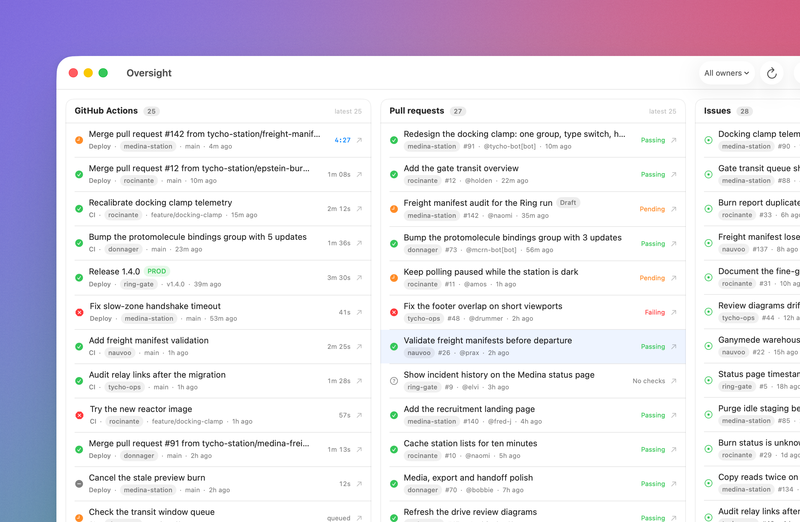

<p align="center">
  
</p>

# Oversight

A macOS app that shows what's happening across every GitHub repo you own, in one
window: the latest workflow runs, open pull requests with their CI status, and
open issues.

Read-only. It never writes to GitHub.

<p align="center">
  
</p>

## Requirements

- macOS 15 or later
- Xcode with a Swift 6 toolchain (built and tested with Xcode 27.1 / Swift 6.4)
- [XcodeGen](https://github.com/yonaskolb/XcodeGen) (`brew install xcodegen`) to
  regenerate the project after adding or renaming files

## Build and run

```sh
xcodegen generate
open Oversight.xcodeproj
```

Or from the command line:

```sh
xcodebuild -project Oversight.xcodeproj -scheme Oversight -destination 'platform=macOS' build
xcodebuild -project Oversight.xcodeproj -scheme Oversight -destination 'platform=macOS' test
```

`Oversight.xcodeproj` is generated from `project.yml`. Never edit the
`.pbxproj` by hand, and run `xcodegen generate` after adding, removing or
renaming a source file.

## Setting up a token

Oversight needs one fine-grained personal access token per owner (a user or an
organization), because GitHub's fine-grained tokens are scoped to a single
owner.

1. Create a token at
   [github.com/settings/personal-access-tokens/new](https://github.com/settings/personal-access-tokens/new)
   for the owner you want to watch.
2. Under **Repository access**, include the repositories you want to see. If the
   token is for an organization, the organization has to allow fine-grained
   tokens.
3. Grant these **read-only** permissions:

   | Permission | Access |
   | --- | --- |
   | Metadata | Read |
   | Actions | Read |
   | Pull requests | Read |
   | Issues | Read |

4. In Oversight, open **Settings** (⌘,) and choose **Add owner…**. Enter the
   owner name and the token. Oversight checks the token with GitHub, confirms
   the token can list repositories, records whether the owner is a user or an
   organization, and stores the token in the macOS Keychain.

The first owner, `alexpricedev`, is already configured; it just needs a token.
Tokens are stored as generic-password items in your login keychain under
`com.chptrs.oversight.tokens`, one per owner. Nothing secret is written to
UserDefaults or to disk.

## What it shows

The window is three columns — **GitHub Actions**, **Pull requests** and
**Issues** — so everything is visible at once. Each column keeps its header and
scrolls its rows.

- **GitHub Actions** — the newest 25 workflow runs across all visible
  repositories, first in first out: a new run appears at the top and the oldest
  drops off. Runs that are still queued or in progress always stay in the feed
  and show a live clock, even if newer runs would otherwise push them out. Each
  row names the workflow, repo and ref, and a `v*` tag is marked **PROD**.
- **Pull requests** — the newest 25 open PRs, with repo, number, author, age,
  draft badge, and the CI status of the head commit (from the workflow runs for
  that head SHA, since fine-grained tokens can't read the Checks API). The
  count badge shows how many open PRs there are in total.
- **Issues** — open issues with labels and age, newest first.

Clicking any row opens it on github.com.

Only source repositories are included: forks and archived repositories are
excluded. Repositories you never want to see can be hidden in Settings without
archiving them on GitHub.

## Polling and rate limits

| What | How often |
| --- | --- |
| Repo with a run in progress | 15 seconds |
| Repo pushed to in the last 7 days | 60 seconds |
| Any other repo | 10 minutes |
| Repo list | 10 minutes |
| Pull requests (per repo) and issues (search) | 60 seconds |
| CI status while checks are running | 60 seconds |
| CI status once settled | rechecked hourly, or on ⌘R |

Every response's `ETag` is kept and sent back as `If-None-Match`; a
`304 Not Modified` reuses the cached body and doesn't count against the limit.
`x-ratelimit-remaining` and `x-ratelimit-reset` are read on every response and
shown in the footer. Below 10% remaining, polling slows to a quarter of the
normal rate; at zero it waits for the reset.

Polling pauses when the window is closed or minimised, when the app is hidden,
when the Mac sleeps, or when the session locks. Reopening the window refreshes
immediately. ⌘R forces a full refresh.

## Errors

Errors appear in place, never as alerts:

- A rejected or under-permissioned token shows a banner for that owner with a
  link to Settings.
- A repository whose call fails keeps the rows it last had and shows a small
  warning triangle with the reason.
- The footer shows the last refresh time and the remaining API allowance for
  each token.

## Demo mode

For screenshots, or to check the layout without a token:

```sh
open Oversight.app --args --demo
```

That runs the real app against in-app fixture data — six fictional repos
(`tycho-station/rocinante`, `medina-station`, `donnager`, `nauvoo`,
`ring-gate`, `tycho-ops`), a full Actions feed, 27 pull requests and 28 issues
— and never touches the Keychain or the network. Quit and reopen without
`--demo` to go back to live data.

## App icon

The icon is generated rather than hand-exported, so it matches the app's three
columns — one of them active and passing:

```sh
swift Scripts/GenerateAppIcon.swift
```

That rewrites `Sources/Assets.xcassets/AppIcon.appiconset` at every macOS icon
size, which is also what the logo at the top of this README points at. Pass a second argument to also write a contact sheet of the icon at
16–256 pt on light and dark backgrounds for review.

## Project layout

```
Sources/
  App/          app entry point, single window, commands, window visibility
  Models/       owners, repos, runs, rows, CI rollup, rate-limit info
  GitHub/       API client behind GitHubClientProtocol, transport, ETags, ledger
  Auth/         Keychain token store
  Settings/     owner and hidden-repo settings, add-owner sheet
  Dashboard/    polling planner and cadence, dashboard model, views
  Support/      date and duration formatting
Scripts/
  GenerateAppIcon.swift   draws the app icon and the asset catalog
Tests/OversightTests/
  Fixtures/     GitHub API responses used by the fake client and transport
  Support/      stub transport, fake client, test clock, sample models
```

The GitHub client sits behind `GitHubClientProtocol`, with fixture-driven fakes
in the tests, so no test touches the network. HTTP behaviour (ETags, headers,
pagination, error mapping) is tested by injecting a `StubTransport` under
`GitHubAPIClient`.

The tests cover action-row parsing, the 25-run feed and running-run pinning,
PR CI rollups, polling intervals and rate-limit backoff, ETag/304 handling,
owner/repo filtering, hidden repos, token-error banners, and per-repo failure
retention.

## Notes and limits

- Pull requests come from `GET /repos/{owner}/{repo}/pulls?state=open`, not
  the search API: search's `pull_request` object has no head SHA, and the CI
  status depends on it. Issues still come from search, one call per owner.
  If search ever hides private repos for a token, the per-repo
  `/issues` endpoint is the fallback.
- The Actions feed is built from the last 20 runs per repository, so a
  repository busy enough to push an older run off that page won't contribute it
  to the global 25.
- The app is built and run locally from Xcode. It isn't notarised for
  distribution.
